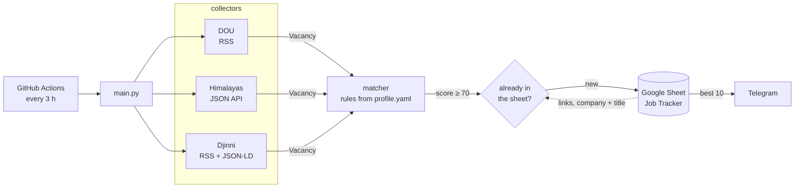

# Job Matcher

[](https://github.com/dim-dimy4/job-matcher/actions/workflows/ci.yml)
[](https://github.com/dim-dimy4/job-matcher/actions/workflows/schedule.yml)
[](https://github.com/dim-dimy4/job-matcher/actions/workflows/contract.yml)

Collects QA vacancies (DOU, Himalayas, Djinni), scores them against a candidate profile, sends the good ones to Telegram and logs them in a Google Sheet. Spec: [docs/SPEC.md](docs/SPEC.md).

> Status: MVP done (stage 6 of 6) — runs every 3 hours on GitHub Actions. Next (v2): more sources, LLM scoring, status buttons in Telegram.

## Architecture



| Part | Module | Role |
|---|---|---|
| Collectors | [`collectors/`](src/job_matcher/collectors) | One module per board, official feeds/APIs only; each normalizes into the pydantic `Vacancy` model and skips its own failures, so one broken board doesn't stop the run |
| Matcher | [`matcher.py`](src/job_matcher/matcher.py) | Pure function `score(vacancy, profile)`: hard filters, then points, every point with a reason |
| Tracker | [`tracker/sheets.py`](src/job_matcher/tracker/sheets.py) | Appends rows and doubles as the dedup memory: a GitHub runner starts clean, so the sheet is the state that survives between runs |
| Notifier | [`notifier/telegram.py`](src/job_matcher/notifier/telegram.py) | One message per vacancy, at most 10 per run; written after the sheet, so a failed message is never resent |
| Pipeline | [`main.py`](src/job_matcher/main.py) | Wiring and `--dry-run`; outputs are passed in, so tests run it with fakes |

Workflows: [`ci.yml`](.github/workflows/ci.yml) runs ruff and pytest on every pull request and on `main` (required to merge); [`schedule.yml`](.github/workflows/schedule.yml) runs the search every 3 hours and on demand (*Run workflow*); [`contract.yml`](.github/workflows/contract.yml) checks the live sources daily, separately, so a change on a job board doesn't block pull requests.

## Local setup

Requires Python 3.12+.

```bash
python -m venv .venv
.venv\Scripts\activate          # Linux/macOS: source .venv/bin/activate
pip install -e ".[dev]"

ruff check . && ruff format --check .
pytest --cov            # unit tests, offline
pytest -m contract      # live checks that the sources still return the expected shape
```

Print current QA vacancies from a source, or run the whole pipeline:

```bash
python -m job_matcher.collectors.dou
python -m job_matcher.collectors.himalayas

job-matcher --dry-run   # collect and score, print the matches; no secrets needed
job-matcher             # full run: new matches to the sheet, the best 10 to Telegram
```

## Sources

| Source | How | Notes |
|---|---|---|
| DOU.ua | Official RSS feeds (`category=QA`, `remote` and `relocation`) | 2 requests per run, deduplicated by URL; robots.txt allows `/vacancies/` |
| [Himalayas](https://himalayas.app) | Official public [Remote Jobs API](https://himalayas.app/api), `q=QA&country=PL` | Up to 2 pages per run; links point to the job on Himalayas, whose Apply button is the `applicationLink` required by the [API terms](https://himalayas.app/terms#api) |
| [Djinni](https://djinni.co) | Official RSS (`QA Automation` and `QA`, remote, 5+ years), then the schema.org `JobPosting` data of each job page for company, location and salary | Up to 2 feeds + 30 job pages per run, 2 s apart; robots.txt allows `/jobs/` |

JustJoin.it and No Fluff Jobs were considered and rejected: their robots.txt and terms forbid automated collection (details in [SPEC §4.1](docs/SPEC.md)).

## Matching

Rules from [SPEC §6](docs/SPEC.md), profile data in [config/profile.yaml](config/profile.yaml). Hard filters (minus keywords, another stack in the title, Polish above B1, junior, not a QA role, location, salary below the minimum) give 0; otherwise points add up: role +30, Senior/Lead +20, plus keywords +5 each (max +30), remote from Poland/EU/abroad or Wrocław +10, salary reaching the target +10, middle without a salary range −20. A remote post that names only Ukrainian cities gets no location points and the reason "check location". Salary thresholds in `profile.yaml` are examples; the real ones are read from the `SALARY_MINIMUM` and `SALARY_TARGET` environment variables. Every score comes with its reasons, e.g.

```
80  Senior QA Automation Engineer @ Codest
    +30 role: QA; +20 seniority: senior; +10 keywords: Python, Pytest;
    +10 remote: Poland; +10 salary up to 23000 PLN reaches the target
```

## Outputs

New vacancies scoring at least `notify_threshold` (70) are appended to the "Job Tracker" Google Sheet, and the 10 best of them are sent to Telegram. The sheet is also the dedup memory: a vacancy whose link, or company + title, is already there is skipped, so a job posted on both boards arrives once.

One-time setup (secrets go in `.env`, template `.env.example`; it is git-ignored):

1. **Telegram.** Create a bot with [@BotFather](https://t.me/BotFather) → `TELEGRAM_BOT_TOKEN`. Send the bot any message, then open `https://api.telegram.org/bot<token>/getUpdates` and copy `chat.id` → `TELEGRAM_CHAT_ID`.
2. **Google Cloud.** Create a project, enable the *Google Sheets API*, create a service account and a JSON key for it. Put the key file next to the project as `*.service-account.json` (git-ignored) and set `GOOGLE_SERVICE_ACCOUNT_JSON` to its path; in GitHub Secrets put the JSON itself.
3. **Sheet.** Create an empty Google Sheet, share it with the service account's `client_email` as Editor, and copy the ID from its URL (`/spreadsheets/d/<ID>/edit`) → `SHEET_ID`. The bot writes the header on the first run; add the Status dropdown yourself (Data → Data validation).

The bot uses only the `spreadsheets` scope: it can edit the sheets shared with it and nothing else in Drive.

For the schedule, add the same six values as repository secrets (*Settings → Secrets and variables → Actions*): `TELEGRAM_BOT_TOKEN`, `TELEGRAM_CHAT_ID`, `GOOGLE_SERVICE_ACCOUNT_JSON` (the key JSON itself, not a path), `SHEET_ID`, `SALARY_MINIMUM`, `SALARY_TARGET`. GitHub masks secret values in the logs.

GitHub pauses scheduled workflows in a public repository after 60 days without commits; re-enable it on the Actions tab. Scheduled runs may also start several minutes late.
